<p align="center">
  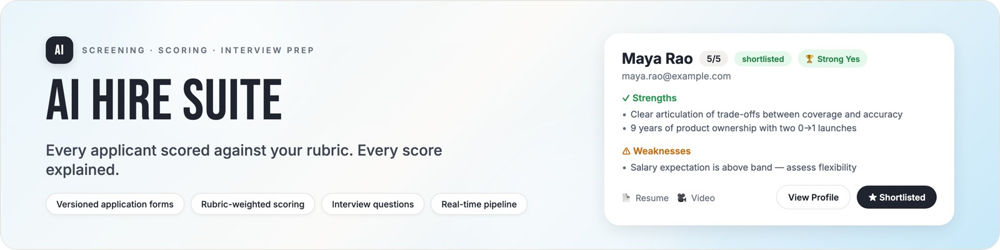
</p>

<p align="center">
  <b>A screening workspace for recruiting teams. Build the application form, let the AI score every applicant against your rubric, and walk into interviews with the evidence and the questions already prepared.</b>
</p>

<p align="center">
  <a href="https://ai-hire-suite-production.up.railway.app"></a>
  
  
  
  <a href="LICENSE"></a>
</p>

<p align="center">
  <a href="https://ai-hire-suite-production.up.railway.app/dashboard"><b>Open the live demo</b></a> ·
  <a href="https://ai-hire-suite-production.up.railway.app/apply/950caea1-51d2-4364-a288-89f127b606e5">Apply to a demo job as a candidate</a>
</p>

<table align="center">
  <tr>
    <td align="center">
      <b>Demo login</b> &nbsp;·&nbsp; fictional data, click anything<br>
      <code>demo.recruiter@aihiresuite.app</code> &nbsp;·&nbsp; <code>Demo-Recruiter-d82c50b2!</code>
    </td>
  </tr>
</table>

<br>

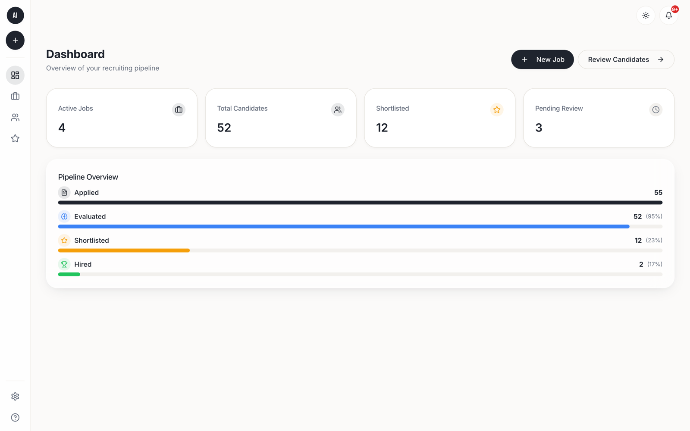

<p align="center"><sub>The recruiter dashboard. Every number is live from the database.</sub></p>

<br>

## What it does

Screening is where hiring quality is decided, and it is usually done from memory: a recruiter reads hundreds of resumes against a job description in their head, and the reasoning behind each decision is gone the moment it is made.

AI Hire Suite makes that work visible and consistent:

- **One rubric per job, written down.** You decide what matters for the role and how much. Every applicant is scored against the same criteria.
- **Every score comes with its reasons.** Strengths, gaps, a clear recommendation, and interview questions aimed at what the score could not settle.
- **Your decisions sit next to the AI's.** Shortlist, hold, pass or hire is recorded beside the recommendation, so you can see where you and the model agree and where you do not.
- **Nothing waits for a refresh.** New applications and new scores appear the moment they land.

<br>

## The screening loop, end to end

<table>
  <tr>
    <td width="50%" valign="top">
      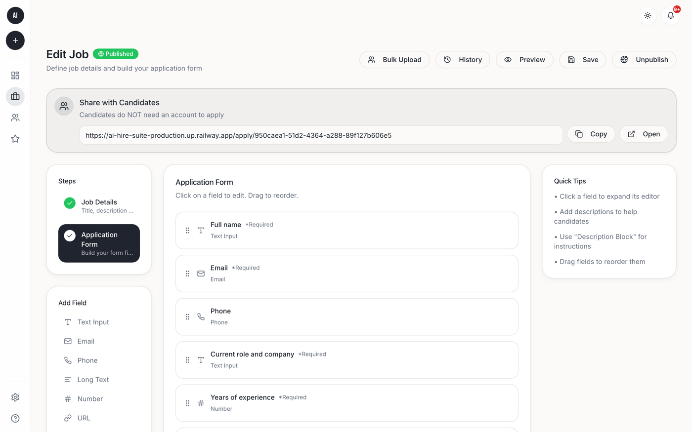
      <br><b>1 · Build the job and its application form</b><br>
      <sub>Twelve field types, drag-and-drop ordering, live preview, and a version history. Publishing a new version never changes the answers already collected.</sub>
    </td>
    <td width="50%" valign="top">
      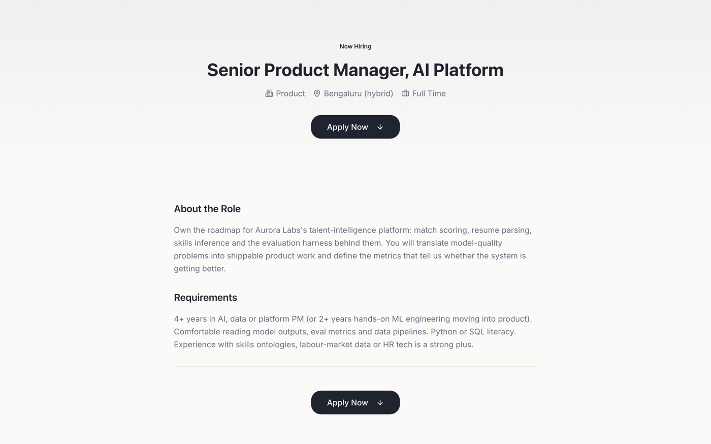
      <br><b>2 · Candidates apply on a public link</b><br>
      <sub>Each job gets a shareable apply page. No account needed. Resumes and optional video introductions upload directly.</sub>
    </td>
  </tr>
  <tr>
    <td width="50%" valign="top">
      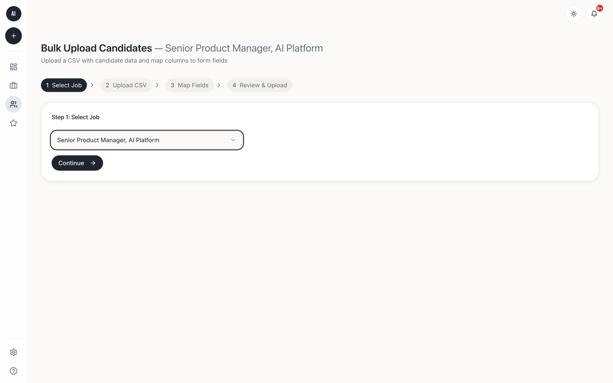
      <br><b>3 · Or bring an existing pipeline in bulk</b><br>
      <sub>Upload a CSV. The mapper suggests which column belongs to which form field, with a confidence score for each guess. Drop the resume PDFs and they attach themselves by filename.</sub>
    </td>
    <td width="50%" valign="top">
      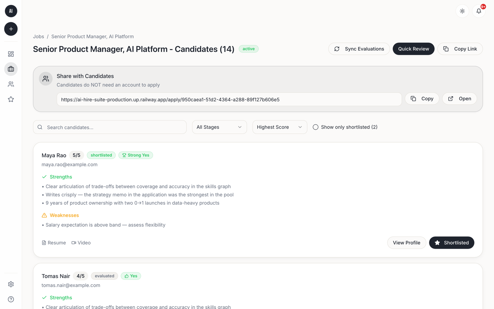
      <br><b>4 · Every applicant is scored against the rubric</b><br>
      <sub>Ranked by score, badged from Strong Yes to Strong No, filterable by stage. New scores re-sort the list as they arrive.</sub>
    </td>
  </tr>
  <tr>
    <td width="50%" valign="top">
      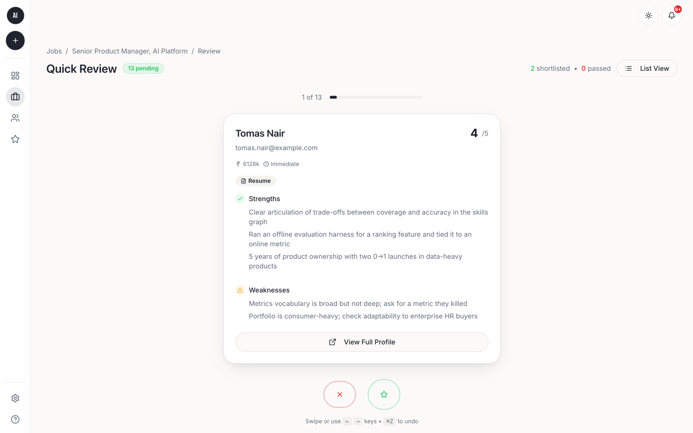
      <br><b>5 · Decide quickly, with the evidence in front of you</b><br>
      <sub>Quick Review shows one candidate at a time: score, strengths, gaps, recommendation. Shortlist or pass with a swipe or a key, undo with another.</sub>
    </td>
    <td width="50%" valign="top">
      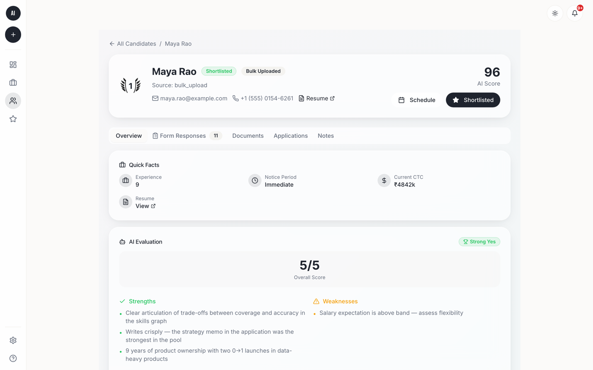
      <br><b>6 · Walk into the interview prepared</b><br>
      <sub>The profile holds the full evaluation, the resume, the form answers, shared notes, and interview questions written for this candidate's gaps.</sub>
    </td>
  </tr>
</table>

<details>
<summary><b>More screens</b> (landing page, shortlist, all candidates, notifications, settings, mobile)</summary>
<br>
<table>
  <tr>
    <td width="67%" valign="top">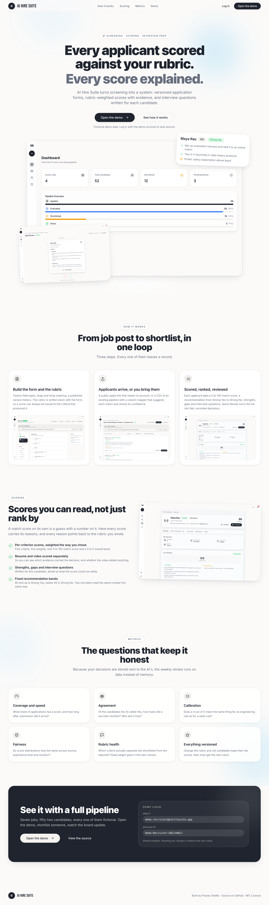<br><sub><b>Landing page</b>: what the product is, how it works, and a demo login</sub></td>
    <td width="33%" valign="top">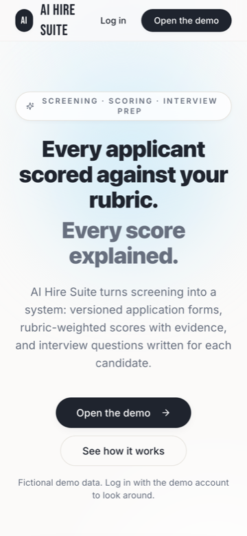<br><sub><b>Landing on a phone</b></sub></td>
  </tr>
</table>
<br>
<table>
  <tr>
    <td width="33%">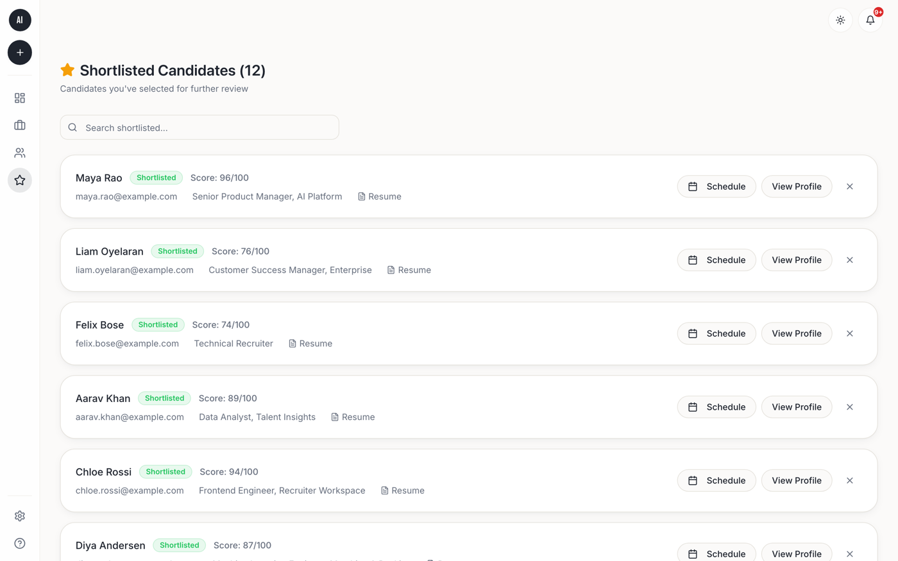<br><sub><b>Shortlist</b> across all jobs</sub></td>
    <td width="33%">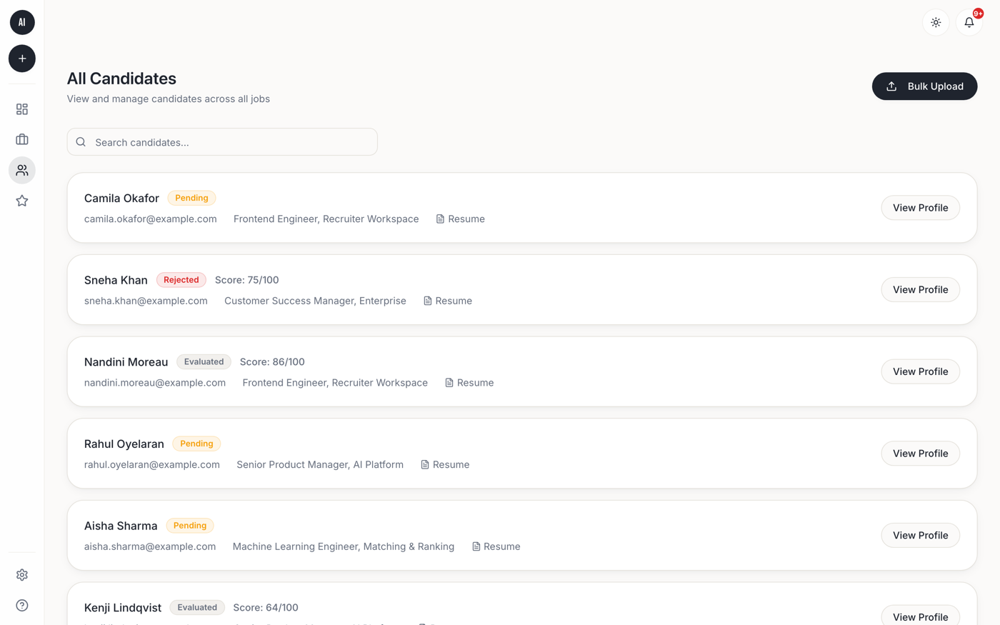<br><sub><b>All candidates</b>, with source and skills</sub></td>
    <td width="33%">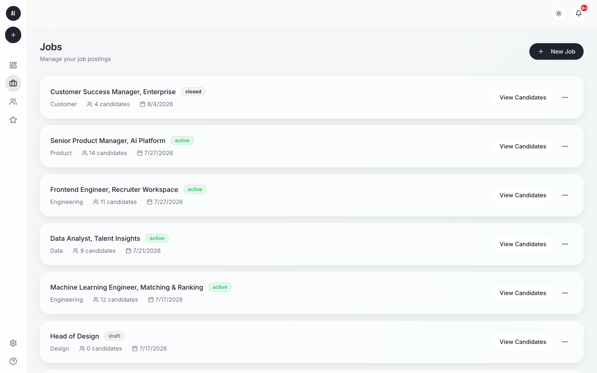<br><sub><b>Jobs</b> with status and candidate counts</sub></td>
  </tr>
  <tr>
    <td width="33%">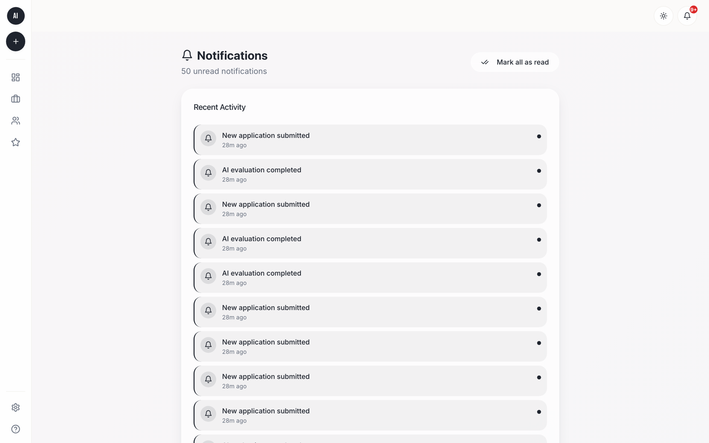<br><sub><b>Notifications</b> for every new application, score, shortlist and note</sub></td>
    <td width="33%">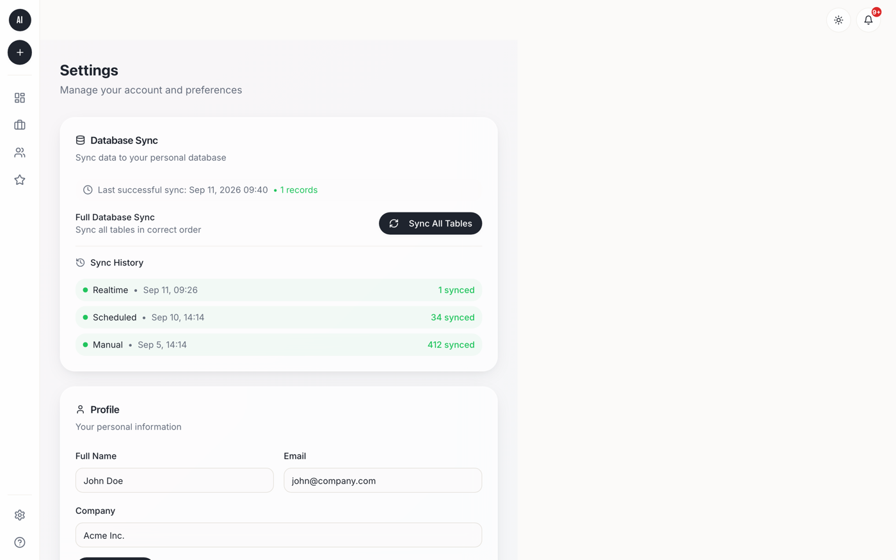<br><sub><b>Settings</b>, including export to an external database with an audit trail</sub></td>
    <td width="33%">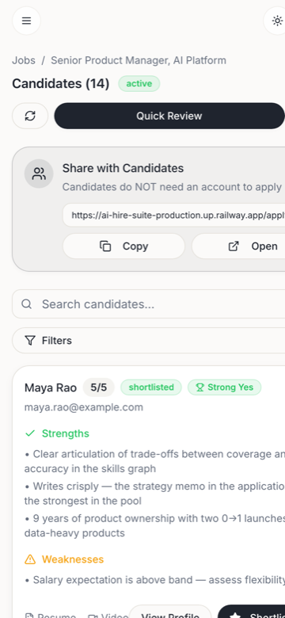<br><sub><b>Mobile</b>: the ranked list on a phone</sub></td>
  </tr>
</table>
</details>

<br>

## How the scoring works

Each job carries a rubric: a handful of criteria, each with a weight, each scored 0 to 5. The evaluation records the score for every criterion, rolls them up into a 0 to 100 match score and a 0 to 5 overall band, and scores the resume and the video introduction separately so you can see which evidence carried the decision.

The recommendation is a fixed band over the match score, so two recruiters looking at the same number always read it the same way:

| Match score | Recommendation |
|:---:|:---:|
| 85 – 100 | **Strong Yes** |
| 72 – 84 | **Yes** |
| 58 – 71 | **Maybe** |
| 45 – 57 | **No** |
| 0 – 44 | **Strong No** |

Alongside the numbers, every evaluation stores three strengths, the gaps worth probing, a short summary, the interview questions it suggests, the model that produced it, and the exact version of the form and rubric it was scored against. Change the rubric and old candidates keep their old scores; new ones get the new rubric.

<br>

## Under the hood, briefly

- **Forms and rubrics are versioned together.** A job has a form, a form has versions, and each version carries both the questions and the rubric. Every application and every score points at the version it was collected under.
- **Resume and video are separate evidence.** Each is stored and scored on its own, which is what lets you ask whether the video adds anything the resume did not.
- **Skills are data, not prose.** Candidates carry a list of skills, the application form captures self-declared skills, and rubric criteria name the skills the role needs.
- **Real time by default.** New applications and scores are pushed to the screens that show them. No polling, no refresh.
- **Everything leaves a trail.** Every state change lands in an activity log that fans out into per-user notifications, and exports to an external analytics database are recorded in an audit log.

### Data model

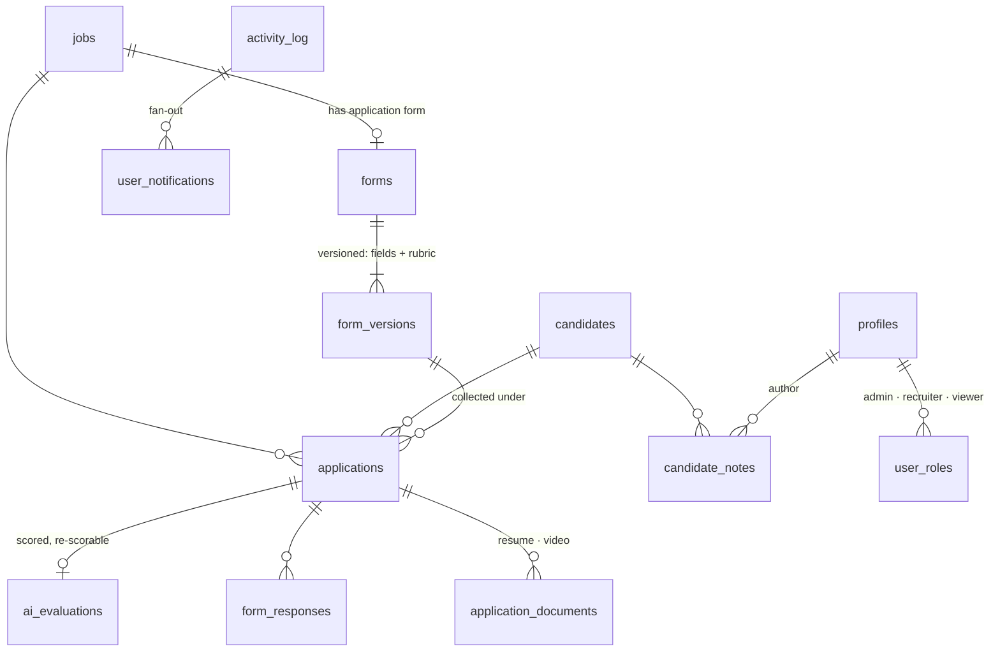

<br>

## The metrics that keep it honest

Because decisions and scores are stored side by side, the questions a hiring team should ask every week can be answered from the data rather than from memory:

- **Coverage and speed.** What share of applications has a score, and how long after submission did it arrive?
- **Agreement.** Of the candidates the AI called Strong Yes or Yes, how many did a recruiter actually shortlist? Of the people shortlisted, how many did the AI miss?
- **Calibration.** Does a 4 out of 5 mean the same thing for an engineering role as for a sales role?
- **Fairness.** Do score distributions look the same across application source, experience level and location?
- **Rubric health.** Which criteria actually separate the shortlisted from the rejected? A criterion with no spread is dead weight and should be removed in the next version.

<br>

## Built with

React 18 and TypeScript on Vite, shadcn/ui and Tailwind for the interface, TanStack Query for data, Recharts, dnd-kit and PapaParse for the dashboard, form builder and CSV import. Supabase provides Postgres with row-level security, authentication, file storage, realtime updates and edge functions. The app is hosted on Railway.

```
src/pages/          Dashboard · Jobs · Form builder · Candidates · Quick Review · Profile · Bulk upload · Shortlist · Settings
src/components/     candidates · dashboard · form-builder · bulk-upload · ui
supabase/           migrations (schema, security policies, triggers) · edge functions
scripts/            provision a backend · apply migrations · seed demo data · screenshot the app
```

<details>
<summary><b>Run it locally</b></summary>

```bash
git clone https://github.com/V00nikos/ai-hire-suite && cd ai-hire-suite
npm install
cp .env.example .env        # point at your Supabase project
npm run dev                 # http://localhost:8080
```

To create your own backend without the Supabase CLI, save a personal access token at `~/.config/supabase/pat` and run the three scripts in `scripts/` in order: provision, apply migrations, seed. Deploying to Railway is `railway init` and `railway up` with the three `VITE_*` variables set on the service.
</details>

<br>

## Security and data

- Access is controlled in the database itself. Applicants can submit an application without an account but can never read anything back. Only signed-in team members see candidates and scores.
- Roles are admin, recruiter and viewer. The demo treats every signed-in profile as a recruiter; a real deployment would make that invite-only.
- The demo contains **no real people**. Every name, email address, phone number, employer and resume was generated for the demo, and each PDF says so in its footer.
- No secrets are committed to this repository.

<br>

<p align="center">
  Built by <b>Pranav Shelke</b> · <a href="LICENSE">MIT License</a>
</p>
