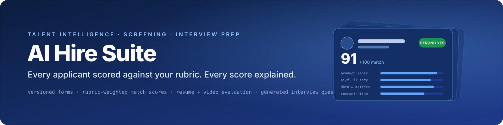
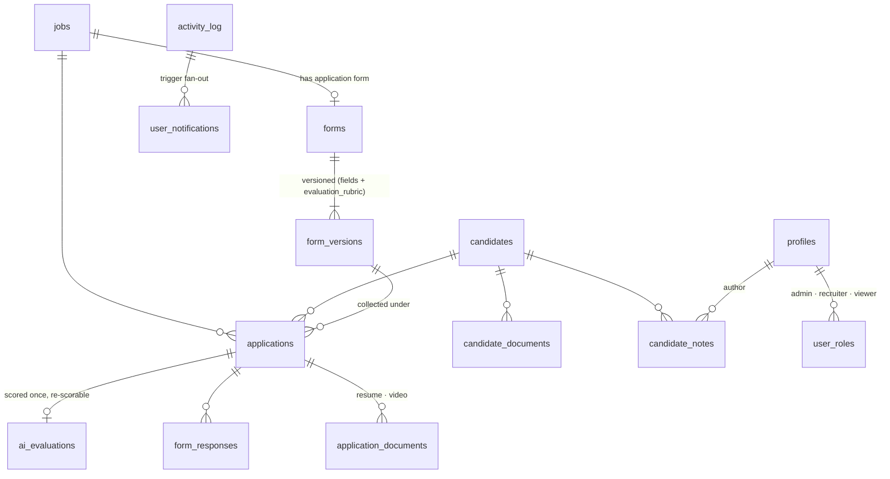

<p align="center">
  
</p>

<p align="center">
  <b>A recruiter's screening workspace where every applicant is scored against a versioned rubric, every score comes with evidence and interview questions, and the whole pipeline updates in real time.</b>
</p>

<p align="center">
  <a href="https://ai-hire-suite-production.up.railway.app"></a>
  
  
  
</p>

<p align="center">
  
  
  
  
  <a href="LICENSE"></a>
</p>

<p align="center">
  <a href="https://ai-hire-suite-production.up.railway.app/dashboard"><b>Open the live demo</b></a> ·
  <a href="https://ai-hire-suite-production.up.railway.app/apply/950caea1-51d2-4364-a288-89f127b606e5">Apply to a demo job as a candidate</a> ·
  <a href="#talent-intelligence-under-the-hood">How the scoring works</a> ·
  <a href="#the-metrics-a-platform-pm-would-watch">Metrics</a>
</p>

<table align="center">
  <tr>
    <td align="center">
      <b>Demo login</b> (fictional data, safe to click anything)<br>
      <code>demo.recruiter@aihiresuite.app</code> · <code>Demo-Recruiter-d82c50b2!</code>
    </td>
  </tr>
</table>

<br>


<p align="center"><sub>The recruiter dashboard. Every number is computed live from Postgres, and the funnel's "evaluated" bar is the model's coverage of the pipeline.</sub></p>

<br>

## Why this exists

Screening is where hiring quality is decided and where it is least instrumented. Recruiters read hundreds of resumes against a job description that lives in their head, and the reasoning behind each shortlist decision evaporates the moment it is made. When an AI model is added on top, it usually arrives as an opaque score with no rubric, no version, and no way to tell whether it is getting better or worse.

AI Hire Suite treats screening as a **measurable system**:

- The job's application form and its **evaluation rubric are versioned together**, so a score can always be traced to the exact criteria and weights that produced it.
- Every AI evaluation stores its **evidence**: weighted rubric scores, strengths, gaps, a recommendation band, the interview questions it suggests, and the model that produced it.
- Recruiter decisions (shortlist, hold, reject, hire) are recorded next to the AI's recommendation, which is what makes **agreement, calibration and bias** measurable instead of anecdotal.

The UI still carries the product's working name, Vortex HR. I built it as a hands-on study of the talent-intelligence problems that platforms like Eightfold work on at scale: match scoring, resume parsing, skills signals, AI-assisted interviewing, and the data-quality loop that has to sit underneath all of them. The section on [how it maps to Eightfold's stack](#how-this-maps-to-eightfolds-talent-intelligence-stack) is explicit about that.

<br>

## The screening loop, end to end

<table>
  <tr>
    <td width="50%" valign="top">
      
      <br><b>1 · Build the job and its form</b><br>
      <sub>Twelve field types (text, file, video, multi-select, description blocks and more), drag-and-drop ordering, live preview, and a <b>version history</b>. Publishing a new version never rewrites the responses collected under the old one.</sub>
    </td>
    <td width="50%" valign="top">
      
      <br><b>2 · Candidates apply on a public link</b><br>
      <sub>Each job gets a shareable <code>/apply/:jobId</code> page rendered from the published form version. Resumes and optional video introductions upload straight to storage; anonymous submissions are allowed by row-level policy, reads are not.</sub>
    </td>
  </tr>
  <tr>
    <td width="50%" valign="top">
      
      <br><b>3 · Or bulk-load an existing pipeline</b><br>
      <sub>Upload a CSV, and the mapper suggests which column feeds which form field with a <b>confidence score</b> per mapping. Drop the matching resume PDFs and they are matched to rows by filename.</sub>
    </td>
    <td width="50%" valign="top">
      
      <br><b>4 · Every applicant is scored against the rubric</b><br>
      <sub>Ranked by match score, badged by recommendation (Strong Yes → Strong No), filterable by stage. New evaluations arrive over a <b>Postgres realtime channel</b> and re-sort the list without a refresh.</sub>
    </td>
  </tr>
  <tr>
    <td width="50%" valign="top">
      
      <br><b>5 · Decide fast, with the evidence in front of you</b><br>
      <sub><b>Quick Review</b> presents one candidate at a time as a card: score, strengths, gaps, recommendation. Shortlist or pass; the decision is recorded next to the AI's recommendation so the two can be compared later.</sub>
    </td>
    <td width="50%" valign="top">
      
      <br><b>6 · Walk into the interview prepared</b><br>
      <sub>The profile shows the full evaluation: overall and per-source scores (resume, video), rubric breakdown, <b>generated interview questions</b> targeted at the candidate's gaps, the embedded resume, form answers, and shared recruiter notes.</sub>
    </td>
  </tr>
</table>

<details>
<summary><b>More screens</b> (shortlist, all candidates, notifications, settings, mobile)</summary>
<br>
<table>
  <tr>
    <td width="33%"><br><sub><b>Shortlist</b> across all jobs</sub></td>
    <td width="33%"><br><sub><b>All candidates</b>, cross-job, with source and tags</sub></td>
    <td width="33%"><br><sub><b>Jobs</b> with status and candidate counts</sub></td>
  </tr>
  <tr>
    <td width="33%"><br><sub><b>Notifications</b> generated from the activity log by a database trigger</sub></td>
    <td width="33%"><br><sub><b>Settings</b>: sync to an external analytics database, with an audit trail</sub></td>
    <td width="33%"><br><sub><b>Mobile</b>: the ranked list at 390px</sub></td>
  </tr>
</table>
</details>

<br>

## Talent intelligence under the hood

The interesting part is not the UI. It is the shape of the data, because that is what decides whether the system can be evaluated.

### Match scoring

Each job's rubric is a set of weighted criteria on a 0 to 5 scale. The evaluation stores the per-criterion scores, the weighted 0 to 100 match score, a 0 to 5 overall band, and separate scores for each evidence source (resume, video introduction). The recommendation is a fixed band over the match score, so it is auditable rather than vibes:

| Match score | Recommendation |
|---|---|
| 85 – 100 | **STRONG YES** |
| 72 – 84 | **YES** |
| 58 – 71 | **MAYBE** |
| 45 – 57 | **NO** |
| 0 – 44 | **STRONG NO** |

```jsonc
// ai_evaluations row (fictional demo candidate)
{
  "score": 91, "overall_score": 5, "resume_score": 88, "video_score": 93,
  "recommendation": "STRONG YES", "ranking": 1,
  "rubric_scores": { "product_sense": 5, "ai_ml_fluency": 4, "data_and_metrics": 5, "technical_depth": 4, "communication": 5 },
  "strengths": ["Ran an offline evaluation harness for a ranking feature and tied it to an online metric", "…"],
  "weaknesses": ["Has not worked on developer-facing or platform products"],
  "interview_questions": ["A model update improves precision but drops coverage for early-career profiles. What do you ship?", "…"],
  "model_used": "gpt-4o + gemini-2.0-flash",
  "form_version_id": "…"   // the exact rubric + form the score was computed against
}
```

### Resume and video as separate evidence

Resumes are stored as documents with an `extracted_text` slot for the parser output, and scored separately from the video introduction. Keeping the sources apart is what lets you later ask "does the video signal add anything the resume did not?" instead of blending them into one unexplainable number.

### Skills as first-class data

Candidates carry a `tags` array of normalised skills, application forms capture self-declared skills as multi-select fields, and rubric criteria name the skills that matter for the role. Three views of the same thing, which is exactly the reconciliation problem a skills ontology solves at scale.

### Versioned rubrics, reproducible scores

`jobs → forms → form_versions` is the spine. A form version carries both the field schema and the `evaluation_rubric`, and every application and evaluation points at the version it was collected and scored under. Change the rubric and you get a new version, not a silently different score on old candidates.

### Realtime and provenance

Evaluations and application changes are published over Supabase Realtime; the candidate list and dashboard subscribe and invalidate their queries. Every evaluation records `model_used` and `evaluated_at`, and every state change lands in an `activity_log` that a trigger fans out into per-user notifications. A separate `sync_audit_log` tracks exports to an external analytics database (scheduled, manual, or realtime via database webhooks and edge functions).

### Data model



<br>

## The metrics a platform PM would watch

The demo database ships with a fictional pipeline of **52 candidates**, **55 applications** across **7 jobs**, and **52 AI evaluations**. These are the questions I would put on the weekly quality review, with the SQL that answers each one against this schema.

**Evaluation coverage and latency.** What share of applications has a score, and how long after submission did it arrive?

```sql
select
  count(e.id)::float / count(a.id)                                              as coverage,
  percentile_cont(0.5)  within group (order by e.evaluated_at - a.submitted_at) as p50_latency,
  percentile_cont(0.95) within group (order by e.evaluated_at - a.submitted_at) as p95_latency
from applications a
left join ai_evaluations e on e.application_id = a.id;
```

**Agreement between the model and the recruiter.** Of the candidates the AI called STRONG YES or YES, how many did a human actually shortlist? Of the shortlisted, how many did the AI miss? This is precision and recall of the recommendation against the human decision, per job and per rubric version.

```sql
select j.title, fv.version_number,
  sum((e.recommendation in ('STRONG YES','YES') and a.shortlisted)::int)::float
    / nullif(sum((e.recommendation in ('STRONG YES','YES'))::int), 0)   as precision_at_shortlist,
  sum((e.recommendation in ('STRONG YES','YES') and a.shortlisted)::int)::float
    / nullif(sum(a.shortlisted::int), 0)                                 as recall_of_shortlist
from applications a
join ai_evaluations e  on e.application_id = a.id
join jobs j            on j.id = a.job_id
join form_versions fv  on fv.id = a.form_version_id
group by 1, 2 order by 1, 2;
```

**Calibration.** Does a 0.8 mean the same thing across jobs? Bucket match scores and compare shortlist rates per bucket per job family. If the curves diverge, the rubric weights are doing different work in different roles.

**Score distribution by cohort.** Compare score distributions across source (`bulk_upload` vs `application`), years of experience, and location before anyone asks. A disparate-impact check is a query, not a project, when the data is shaped like this.

```sql
select c.source, width_bucket(e.score, 0, 100, 10) as decile, count(*)
from ai_evaluations e
join applications a on a.id = e.application_id
join candidates c   on c.id = a.candidate_id
group by 1, 2 order by 1, 2;
```

**Rubric health.** Which criteria actually separate shortlisted from rejected candidates? A criterion with no spread is dead weight; remove it and re-version.

<br>

## How this maps to Eightfold's talent intelligence stack

Eightfold describes itself as the agentic talent intelligence company: a platform built on 1.6 billion career trajectories and 1.6 million skills, matching on skills rather than keyword search, with Talent Agents (Candidate Agent, AI Interviewer, AI Interview Companion) doing the work while people make the call. This project is a small, fully inspectable version of the same loop. The right-hand column is what I would be pushing on as a PM on the AI Platform and Talent Intelligence team.

| Eightfold capability | What AI Hire Suite does today | What I would drive next, and the metric |
|---|---|---|
| **Match scoring** across roles and candidates | Rubric-weighted 0–100 score with per-criterion breakdown and fixed recommendation bands, stored against the rubric version | A golden set of human-labelled matches per job family; track precision@shortlist, calibration error and inter-rater agreement per model and rubric version |
| **Resume parsing** | Resumes stored as documents with an extracted-text slot and a separate resume score | Parser accuracy as a first-class metric: field-level F1 on a labelled set, coverage of non-English and non-standard resumes, drift alerts when extraction confidence drops |
| **Skills intelligence** | Skills captured three ways (candidate tags, self-declared form answers, rubric criteria) | Normalise all three onto one ontology; measure skills coverage per profile and the lift in match quality from inferred skills versus declared ones |
| **AI interviewing** | Video introductions scored separately; targeted interview questions generated per candidate from their gaps | Structured async interviews: transcript → rubric → evidence; measure question relevance ratings from interviewers and downstream offer-rate lift |
| **Candidate Agent** style experience | Public application pages rendered from versioned forms, anonymous-safe by policy | Conversational apply with skills-based role suggestions; measure completion rate and time-to-apply |
| **Data quality and model performance** | Every evaluation records model, timestamp and rubric version; activity and sync audit logs; realtime propagation | A quality dashboard that is part of the product, not a notebook: coverage, latency, agreement, calibration, cohort parity, all sliced by rubric version |
| **Human-led decisions** | Recruiter decisions stored beside AI recommendations; notes and roles (admin, recruiter, viewer) | Make the disagreement queue a product surface: where humans overrule the model most is where the rubric or the model needs work |

Sources for the Eightfold descriptions: [eightfold.ai](https://eightfold.ai/) and the [Talent Agents 2.0 announcement](https://eightfold.ai/company/press/press-releases/eightfold-ai-grows-talent-agents-to-2-0/) (July 2026).

<br>

## Architecture and stack

- **Frontend.** React 18 + TypeScript on Vite, shadcn/ui and Tailwind, TanStack Query for data, React Router, Recharts for the dashboard, dnd-kit for the form builder, PapaParse for CSV. Deployed as a static SPA on **Railway**.
- **Backend.** **Supabase**: Postgres with row-level security on every table, role helpers (`has_role`, `is_recruiter`), storage buckets for resumes and videos, Realtime on `applications` and `ai_evaluations`, and four Deno edge functions (`realtime-sync`, `scheduled-sync`, `batch-sync-to-personal-db`, `sync-evaluations`) that mirror data to an external analytics database with an audit log.
- **Evaluation.** Scoring runs out of band against the published rubric and writes `ai_evaluations` rows; the app subscribes and updates. The demo data was produced by `scripts/seed-demo.mjs` and labels itself as such; the schema is identical to production.

```
src/pages/          Dashboard · Jobs · JobFormBuilder · JobCandidates · CandidateReview · CandidateProfile
                    Candidates · BulkUpload · Shortlisted · Notifications · Settings · CandidateApplicationForm
src/hooks/          one hook per data concern (useJobs, useCandidates, useAIEvaluationRealtime, useNotifications, …)
src/components/     candidates/ (AIEvaluationCard, CandidateCardStack…) · dashboard/ · form-builder/ · bulk-upload/ · ui/
supabase/           migrations/ (schema, RLS, triggers) · functions/ (edge functions) · config.toml
scripts/            provision-demo-project.mjs · apply-migrations.mjs · seed-demo.mjs · shoot-screens.mjs
```

<br>

## Run it yourself

```bash
git clone https://github.com/V00nikos/ai-hire-suite && cd ai-hire-suite
npm install
cp .env.example .env                     # VITE_SUPABASE_URL, VITE_SUPABASE_PUBLISHABLE_KEY, VITE_SUPABASE_PROJECT_ID
npm run dev                              # http://localhost:8080
```

To stand up your own backend without the Supabase CLI (uses the Management API with a personal access token saved at `~/.config/supabase/pat`):

```bash
node scripts/provision-demo-project.mjs --name my-hire-suite --region ap-south-1   # creates the project, writes .env.demo
node scripts/apply-migrations.mjs <project-ref> --skip 20251228082003             # schema + RLS + triggers (skips the external-sync triggers)
SUPABASE_URL=… SUPABASE_SERVICE_ROLE_KEY=… DEMO_PASSWORD=… npm run seed:demo -- --wipe   # fictional pipeline
```

Deploying to Railway is `railway init && railway up` with the three `VITE_*` variables set on the service; `railway.json` builds with Railpack and serves `dist/` as a single-page app.

<br>

## Security and data notes

- Row-level security is on for every table. Anonymous users can read active jobs and published forms and can submit applications, responses and documents; they cannot read anything back.
- Roles are `admin`, `recruiter`, `viewer`. In this build any authenticated profile counts as a recruiter, which is fine for a sandbox and would become invite-only with domain allow-listing before real use.
- Storage buckets are public-read so embedded resume and video previews work without signed URLs. Production would switch to signed URLs with short expiry.
- The demo database contains **no real people**. Names, emails (`example.com`), phone numbers (reserved ranges), employers and resumes are generated, and every PDF says so in its footer.
- No secrets are committed. `.env` is ignored; only `.env.example` ships.

<br>

## About

Built by **Pranav Shelke**, a product manager who prefers to learn a system by building a working version of it. The sibling project, [Microsite Factory](https://github.com/V00nikos/microsite-factory), applies the same instinct to GTM: an agent pipeline with a QA gate on every stage and an eval trace behind every decision.

Licensed under the [MIT License](LICENSE).
